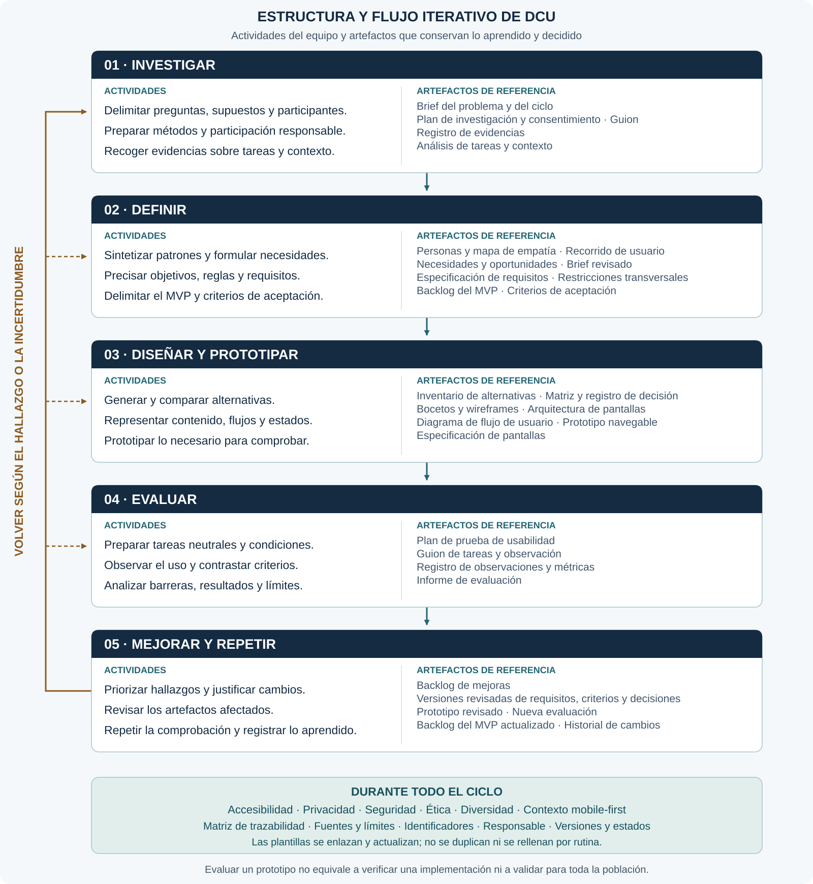

# Estructura y flujo del proceso iterativo DCU

Referencia de distribución de la documentación docente. La fase 01 dispone de aplicaciones para brief, plan y consentimiento, guion, registro de evidencias y análisis de tareas. Las demás fases se mantienen como espacios para futuras herramientas.

| Fase | Propósito y artefactos representativos |
| --- | --- |
| 01 · Investigar | Comprender personas, tareas y contexto. Brief, plan y guion de investigación, registro de evidencias y análisis de tareas. |
| 02 · Definir | Sintetizar necesidades y delimitar alcance. Personas, mapa de empatía, recorrido, requisitos, restricciones, backlog y criterios. |
| 03 · Diseñar y prototipar | Explorar y representar alternativas. Decisiones, bocetos, flujos y prototipos. |
| 04 · Evaluar | Contrastar tareas y criterios con personas. Plan, guion, observaciones e informe de evaluación. |
| 05 · Mejorar y repetir | Priorizar hallazgos, revisar artefactos y repetir comprobaciones. Backlog de mejoras y versiones revisadas. |

Las fases no son cierres definitivos: se vuelve a investigar, definir, diseñar o evaluar según el hallazgo y la incertidumbre. La accesibilidad, privacidad, seguridad, ética y trazabilidad se mantienen durante todo el ciclo.

Consultar el [brief de referencia](brief-oficial.md) y la [gobernanza de trazabilidad](gobernanza-trazabilidad.md). Las plantillas se actualizan según el propósito del ciclo, no se rellenan por rutina.
